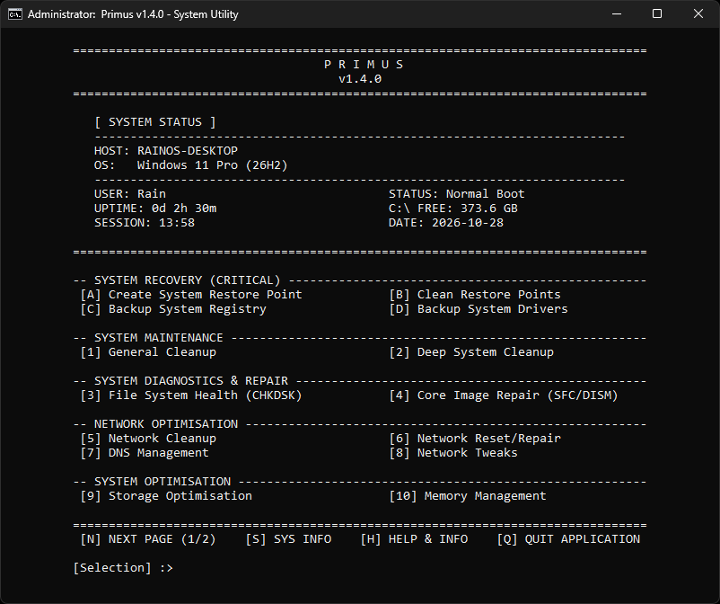

# 🛠️ Primus - System Utility

> Primus is a collection of scripts I use to maintain, clean, and optimise Windows 10/11. It consolidates various system tasks into a single interface with built-in safety checks and logging.

> It uses native Windows tools (SFC, DISM, CHKDSK, and PowerShell) to help with system health, file system issues, and privacy settings. Supports x86, x64, and ARM64 architectures.

---

## ⚡ Features

### **System Recovery** 🔄
- Create manual System Restore Points
- Basic Shadow Copy cleanup (keeps the most recent)
- Registry hive backups (SYSTEM, SOFTWARE, SAM, etc.)
- Emergency Registry restore script generation
- Driver backups via DISM export
- Checks for disk space before running tasks

### **System Maintenance** 🧹
- Organised sub-menus for General and Deep cleanup tasks
- Clean up temporary files (User + System)
- Reset Windows Update download cache
- Clear crash dumps and error reports
- Rebuild icon and font caches (fixes visual glitches)
- Browser cleanup (supports Chromium, Firefox, Arc, and Opera variants)
- App cache deep cleaning (Discord, MS Teams, Xbox Gameplay & Apps)
- Clear BranchCache and Installer Patch Temps
- Safely purge old and superseded driver packages from the Driver Store
- Unregister disconnected ghost/hidden devices (preserves virtual hardware adapters)
- Reset Windows Store cache
- WinSxS Component Store cleanup (Standard + Deep modes with reboot-pending safeguards)
- Clear system event logs

### **System Diagnostics & Repair** 🔧
- Query volume dirty bits
- Read-only integrity scans
- Schedule and cancel offline repairs (with native lock return-code normalisation)
- System File Checker (SFC) with basic log parsing
- DISM health checks and image scans
- DISM image repair with reboot-pending detection

### **Network Optimisation** 🌐
- Display and flush DNS/ARP caches
- Release and renew IP addresses
- Reset TCP/IP stack and Winsock (includes config backups)
- **DNS Management:** Quickly switch active adapters between Cloudflare (Standard/Security/Family), Google, Quad9, AdGuard, or automatic DHCP[cite: 3].
- **Network Tweaks:** Toggle advanced latency and security settings including QoS Reserved Bandwidth, Network Throttling, RSC, Nagle's Algorithm, NetBIOS, and LLMNR[cite: 3].

### **System Optimisation** ⚙️
- SSD TRIM and HDD defragmentation
- CompactOS system compression (Enable/Disable)
- Manage Hibernation file size (Disable / Reduced / Full)
- Toggle Windows Reserved Storage (Build 18362+)
- Shadow Copy storage limits (5GB to 20GB)
- Basic memory usage analysis (grouped by application)
- Clear clipboard and flush standby RAM cache

### **Security & Privacy** 🛡️
- Microsoft Safety Scanner (MSERT) integration (x86/x64/ARM64 auto-detect)
- Reset Windows Firewall to default settings (includes rule backup)
- Windows Defender history and scan log cleanup (with Safe Mode loop prevention)
- Force Defender signature updates
- **Comprehensive 10-Module Privacy Suite:**
  - Control OS Telemetry, Error Reporting (WER), and CEIP Tasks
  - Manage Activity History, Inking/Typing Personalisation, and Tailored Experiences
  - Toggle Feedback Prompts, Cortana Web Search, App Advertising IDs, and global Location Services

### **System UI & Apps** ✨
- **Windows 11 UI Tweaks:** Restore the Classic Context Menu, configure power-user Explorer views, disable Start Menu Recommendations, and remove the Explorer Gallery node[cite: 3].
- **Software & Runtimes (Winget):** Perform global application upgrades, repair package manager indexes, and bulk-install core dependencies (Visual C++, DirectX, .NET 8 & 10)[cite: 3].

### **User Experience & Logging** 📝
- Detection for Windows Insider / Dev Builds
- Consistent UI alignment using a unified multi-parameter toggle engine
- Locale-independent ISO-8601 logging format (YYYY-MM-DD)
- Clean elevation handoff (automatically kills un-elevated ghost terminals)
- Displays reclaimed space after cleanup tasks
- Session summary showing total space freed and duration (with native batch fallbacks)

---

## 🛡️ Safety Checks

| Feature | Description |
|---------|-------------|
| **Admin Check** | Automatically requests elevation and kills the background instance |
| **First-Run EULA** | Requires acknowledgement of risks via zero-byte state marker on first launch |
| **Space Validation** | Skips heavy operations if <2GB free to prevent corruption |
| **WMI Crash Guard** | Gracefully bypasses storage blocks if the system's WMI repository is corrupted |
| **Backup Scripts** | Automatically backs up Registry, Firewall, and Network configs |
| **Locked Files** | Bypasses in-use files without forced deletion |
| **Transactional Rollbacks** | Reverts Safe Mode BCD boot flags if the restart command is blocked by the OS |
| **Build Awareness** | Checks build versions to prevent running unsupported features |
| **Native Exit Normalisation** | Intercepts expected Windows exit codes (e.g., active CHKDSK volume locks) to prevent false-negative errors |

---

## 💻 System Requirements

| Requirement | Specification |
|-------------|---------------|
| **Operating System** | Windows 10 (Build 19041+) or Windows 11 |
| **Edition** | Pro, Enterprise, or Education (Home has limited support) |
| **Privileges** | Administrator rights required |
| **Disk Space** | Minimum 2GB free for repair tasks |

---

### ⚠️ Disclaimer

**Primus is provided "AS-IS" without any warranty.** While I've included safety checks, this utility performs modifications to system files, network settings, and security policies. 

By using this script, you acknowledge you are doing so at your own risk. I am not responsible for any data loss or system instability. **Always create a Restore Point (Option A) before running deep maintenance tasks.**

---

## 📥 Installation

1. Download `Primus.bat` from the [Releases](https://github.com/R4in84/Primus/releases) page.
2. Save it to a folder of your choice.
3. Right-click and **Run as administrator**.
